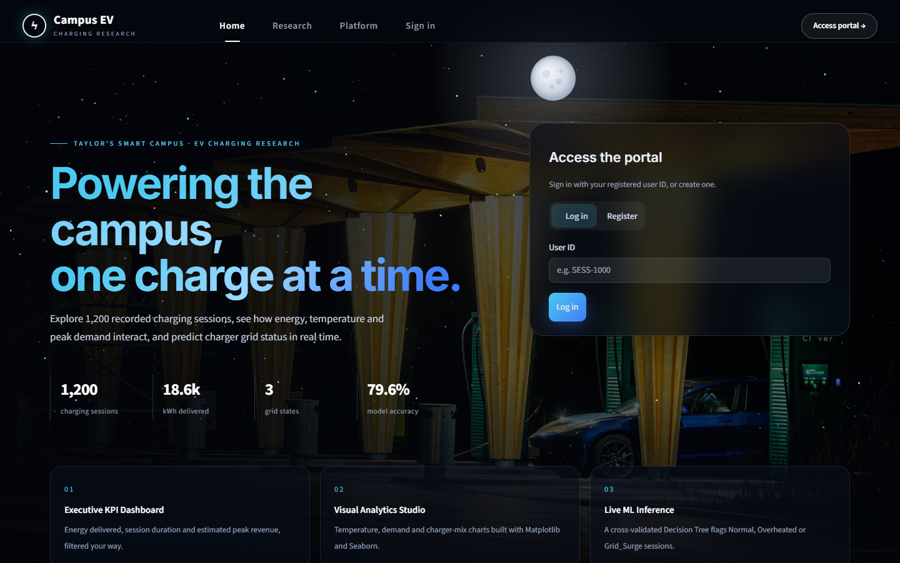
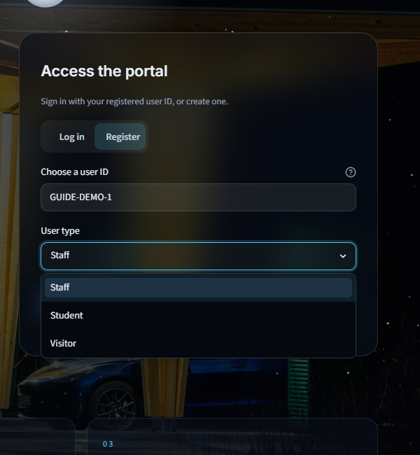
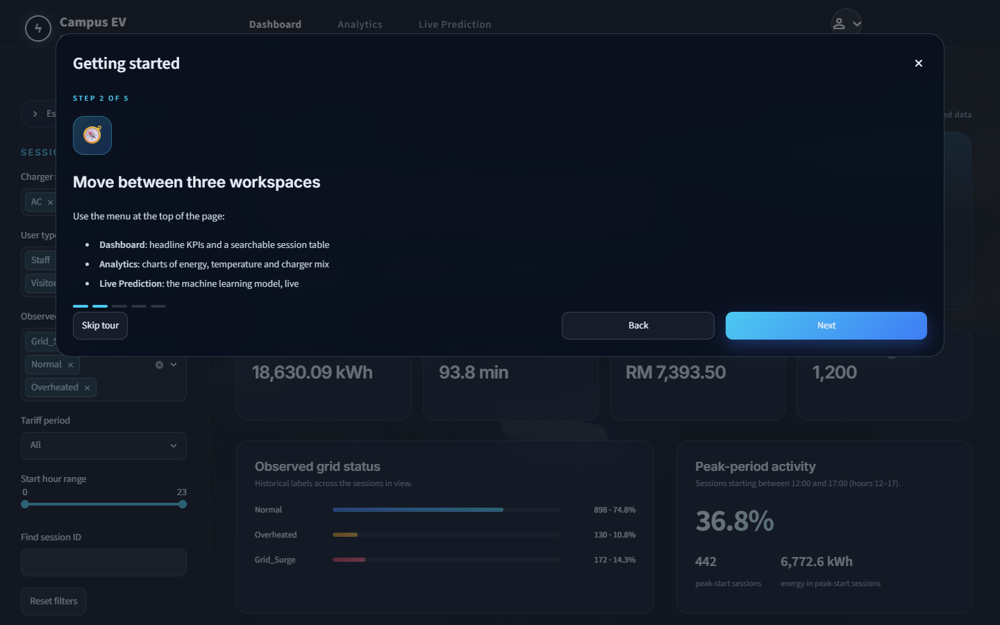
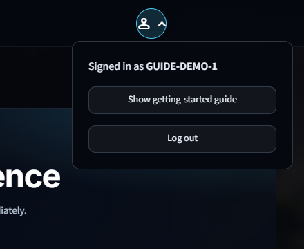
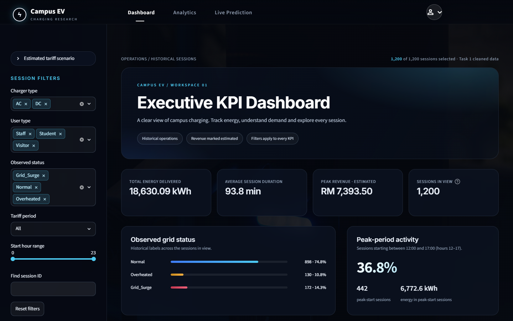
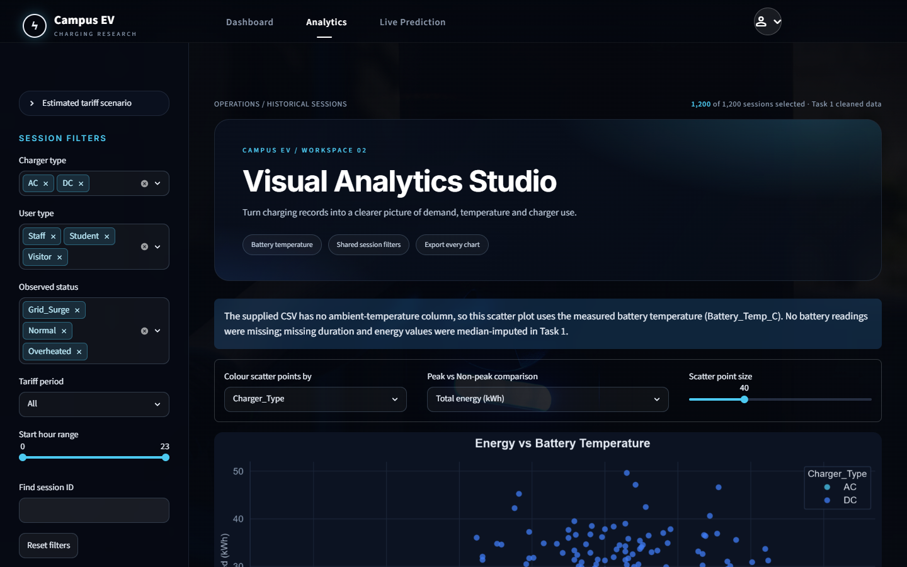
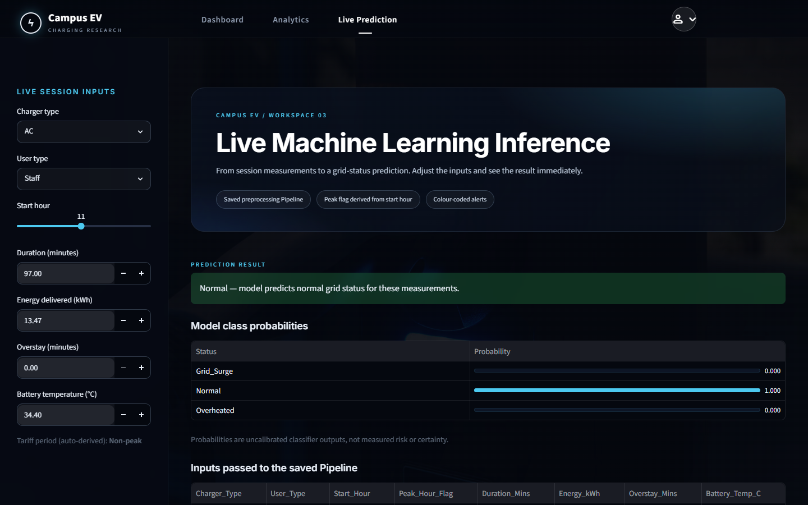

# User guide

How to use every screen of the Campus EV Charging Research Portal.

---

## 1. Signing in

The sign-in page is the public home page. The top menu (**Home · Research ·
Platform · Sign in**) scrolls to each section; **Access portal →** jumps to the
sign-in card. Move the mouse over the page: the stars drift in layers.

### Existing users

Every `Session_ID` in the dataset is a valid user ID (`SESS-1000` to `SESS-2199`).

1. Keep **Log in** selected.
2. Type the ID, for example `SESS-1000`. Upper/lower case and spaces do not matter.
3. Press **Log in** (or Enter).

### New users

If you type an ID that is not in the dataset, the portal answers
*"… is not registered. Please register first."* and offers **Register this ID**.

1. Click **Register this ID**, or select the **Register** tab.
2. **Choose a user ID** – 3 to 20 characters: letters, digits, `-` or `_`.
   The form suggests the next free ID in the dataset's style (e.g. `SESS-2200`).
3. Choose your **User type**: Staff, Student or Visitor.
4. Click **Register**. Your ID is added to `ev_campus_dataset.csv` and you return
   to **Log in** with the ID already filled in.
5. Click **Log in**.

---

## 2. The getting-started guide

On your **first** sign-in after registering, a five-step guide opens:

1. Welcome and what the portal does
2. The three workspaces in the top menu
3. Filtering from the side panel
4. What the green / yellow / red alerts mean
5. The account menu

Use **Next** and **Back** to move through it, **Skip tour** to stop, and
**Get started** on the last step. Finishing or skipping means it will not open
again; closing it with **✕** postpones it to your next sign-in.
Replay it any time from the account menu.

---

## 3. Navigation and account menu

* **Top menu** – Dashboard · Analytics · Live Prediction. The current page is
  white with a short underline.
* **Round button (top right)** – shows who is signed in, **Show getting-started
  guide** and **Log out**.
* **Side panel (left)** – the controls for the current workspace. Collapse it
  with the « arrow at its top.

---

## 4. Dashboard

* **Metric cards:** total energy delivered, average session duration, estimated
  peak revenue, and the number of sessions in view.
* **Observed grid status:** share of Normal, Overheated and Grid_Surge sessions.
* **Peak-period activity:** share and energy of sessions that start 12:00–17:00.
* **Revenue calculation and assumptions:** expand to see exactly how the
  revenue estimate is calculated.
* **Session explorer:** choose table columns, sort by clicking a column header,
  and **Download filtered sessions (CSV)**.

### Filters (side panel)

| Filter | Effect |
|---|---|
| Estimated tariff scenario | Change the peak surcharge (RM per session) for a what-if revenue estimate |
| Charger type / User type / Observed status | Keep only the selected categories |
| Tariff period | All, Peak or Non-peak |
| Start hour range | Keep sessions that start inside the range |
| Find session ID | Text search, e.g. `SESS-10` |
| Reset filters | Back to all 1,200 sessions |

Every number, card, table and chart follows the filters.

---

## 5. Analytics

| Control | Effect |
|---|---|
| Colour scatter points by | Charger type, grid status or user type |
| Peak vs Non-peak comparison | Total energy, average energy or session count |
| Scatter point size | Marker size in the scatter plot |

Charts: **Energy vs Battery Temperature**, **Peak vs Non-peak** and **Charger
Type Distribution**. Each has a **Download chart** button (PNG).

---

## 6. Live Prediction

Enter one session's measurements in the side panel:

| Input | Widget |
|---|---|
| Charger type, User type | drop-down |
| Start hour | slider (the tariff period is derived automatically) |
| Duration, Energy delivered, Overstay, Battery temperature | number boxes |

The prediction updates immediately:

| Banner | Meaning | Suggested action |
|---|---|---|
| 🟢 **Normal** | No issue expected | None |
| 🟡 **Overheated** | Battery temperature indicates overheating | Check the battery and charger hardware |
| 🔴 **Grid_Surge** | Session in the peak window resembles grid-surge events | Check grid load |

Below the banner: class probabilities, the exact inputs given to the model
(downloadable), and **Model performance (Task 2)** with the model comparison,
confusion matrices, feature importance and a "Why not 100 %?" explanation.

Try it: default inputs → green; battery temperature **48** → yellow;
temperature **35** and start hour **14** → red.

---

## 7. Logging out

Open the round account button (top right) → **Log out**. Your filters and
inputs are cleared and you return to the sign-in page.
